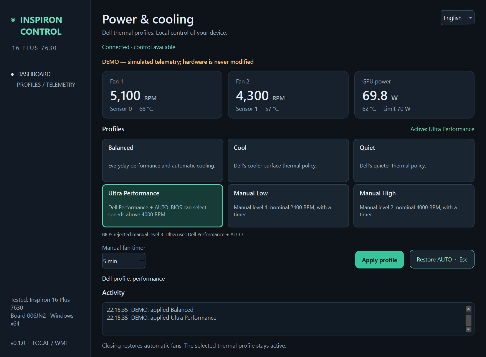

# Dell Inspiron Control

A native Windows control panel for Dell thermal profiles, fan RPM and timed manual fan control.
Tested on **Dell Inspiron 16 Plus 7630, board 006JN2 A00, BIOS 1.30.0**.



## Download and run

Download the Windows x64 portable ZIP from [Releases](../../releases/latest), extract the **whole folder**,
and run `DellInspironControl.exe`. Accept the administrator prompt. Keep `_internal` next to the EXE.
Python, PawnIO and a separate kernel driver are not required on the target machine.

The release executable is unsigned. Windows may show a SmartScreen publisher warning.
No startup task or Windows service is installed. The app does not connect to the internet.

The UI supports Russian and English. Demo mode (`DellInspironControl.exe --demo`) never accesses hardware.

## Profiles

| Preset | Dell thermal policy | Fans |
|---|---|---|
| AUTO | Keeps the current policy | BIOS automatic |
| Balanced | Balanced / Optimized | BIOS automatic |
| Cool | Cool | BIOS automatic |
| Quiet | Quiet | BIOS automatic |
| Ultra Performance | Performance / Ultra Performance | BIOS automatic; can exceed 4000 RPM |
| Manual Low | Keeps the current policy | Both fans, nominal 2400 RPM |
| Manual High | Keeps the current policy | Both fans, nominal 4000 RPM |

Select a profile, then click **Apply profile**. Manual sessions last 1–60 minutes.
**Restore AUTO** or **Esc** ends a manual session immediately. Closing the application restores AUTO
and leaves the selected Dell thermal policy active. Choose Balanced to restore the normal thermal policy.

The app reads the selected policy back from firmware instead of assuming a successful write.
GPU power is load-dependent: Performance was measured at about **69.8 W average** in a CUDA load on the
test laptop, but this does not guarantee 70 W in every game. This app does not unlock or flash TGP/vBIOS.

## Why manual turbo / 6200 RPM is not offered

The test BIOS reports 6200 RPM as the nominal speed of SMM level 3, but **rejects the level-3 setter
with `0xFFFF`**. Nominal capability data alone does not prove a working fan setting. The bounded live
test restored AUTO and the original thermal policy after the rejection. See [hardware validation](docs/hardware-validation.md).

Ultra therefore uses the stock Performance policy with BIOS automatic cooling. This also avoids
limiting BIOS cooling to the lower 4000 RPM manual level. No unsupported level is exposed in the UI.

## Compatibility and safeguards

* Firmware writes are restricted to the tested Dell manufacturer/model/board combination.
  **7830 is not a verified model for this application.** Other Inspiron/G15/G16 models are not enabled by name similarity.
* Uses Dell `LegacyDiags.Execute` and `BFn.DoBFn` WMI providers; administrative rights are required.
* One hardware owner at a time. A new GUI instance cannot take control from an existing manual session.
* An independent recovery process returns AUTO if the controller exits or misses heartbeats for approximately five seconds.
* A second absolute deadline prevents an indefinitely active manual session. Invalid telemetry or either firmware sensor reaching
  90 °C stops manual control. Exact physical locations of firmware temperature sensors 0/1 are not asserted.
* OS/firmware hangs, killing both parent and recovery processes, or BIOS refusal of AUTO cannot be solved by a user-mode watchdog.
  Restart the application and use Restore AUTO; if firmware stops responding, reboot.

There is no fan-stop setting, raw EC write, firmware modification, update downloader or telemetry upload.
Logs stay in `%LOCALAPPDATA%\DellInspironControl`. They are not included in source or releases.

## Build and test

Windows x64 and Python 3.12:

```powershell
python -m venv .venv
.\.venv\Scripts\Activate.ps1
python -m pip install -r requirements-dev.txt
python -m pytest -q
python dell_control.py --demo
.\build.ps1
```

The build creates `dist/DellInspironControl/DellInspironControl.exe` and its runtime directory.
A directory bundle is used for this privileged tool, following
[PyInstaller's guidance for administrator applications](https://pyinstaller.org/en/stable/operating-mode.html).

Explicit checks (not part of ordinary startup):

```powershell
dist\DellInspironControl\DellInspironControl.exe --self-test
dist\DellInspironControl\DellInspironControl.exe --hardware-check
```

`--self-test` uses simulated hardware and writes a GUI report/screenshot to the local log directory.
`--hardware-check` is an **opt-in live hardware test**: it briefly changes a thermal profile and manual
fan settings, tests timeout/heartbeat recovery, then restores the initial thermal policy and AUTO.
It only runs on supported hardware. CI runs unit/GUI simulation tests, not live firmware tests.

## Contributing

For another model, open an issue with its model name, board product and BIOS version. Do not post
service tags, serial numbers, raw ACPI tables or unredacted system dumps. Support must be based on a
bounded hardware validation, not on the presence of a WMI class or a nominal RPM response alone.

Protocol references: [Linux Dell SMM](https://www.kernel.org/doc/html/latest/hwmon/dell-smm-hwmon.html),
[Dell libsmbios thermal control](https://github.com/dell/libsmbios/blob/master/src/bin/smbios-thermal-ctl),
[Dell SMBIOS WMI framing](https://github.com/torvalds/linux/blob/master/drivers/platform/x86/dell/dell-smbios-wmi.c).

MIT license. This is an independent community tool, not a Dell product or endorsement.
